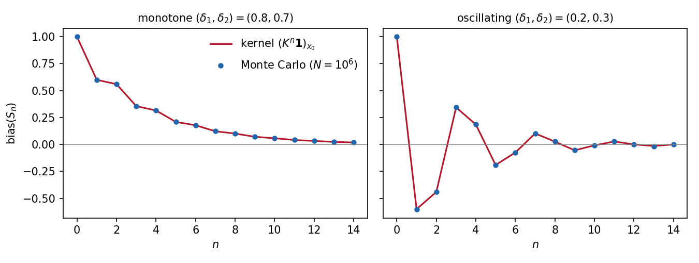

# Markovian Parity Correctors

Supplementary material for *Unpredictability from Parity: Understanding Linear Correctors for Markovian Sources* ([IACR ePrint 2026/2417](https://eprint.iacr.org/2026/2417)).

## Parity for Correcting Bit Balance

The parity operation (XOR) is well-suited to decrease the bias of input bits, as studied in the theory of Boolean functions and commonly adopted in hardware random number generators (Dichtl, Lacharme).

The bias decays geometrically under independent inputs. We extend this to Markov chains, a more realistic randomness model.

## Twisted kernel in brief

Consider a hidden chain on bits: the state is a Markov chain $(\theta_i)$ with transition kernels $\mathbf P^{(i)}$ and initial law $\pi$, and bits are emitted by the deterministic rule $X_i = f(\theta_i)$.

We define the **twisted kernel** $\mathbf K_t^{(i)}=\mathbf P^{(i)} \mathrm{diag}(t^{f})$: essentially, one step of the chain weighted by $t^{\text{emitted bit}}$.

As shown in the manuscript, it factorizes the *generating function* of the hidden chain:

$$\mathbb E t^{X_1+\dots+X_n}=\pi \mathbf K_t^{(1)}\cdots\mathbf K_t^{(n)}\mathbf 1 .$$

Setting $t=-1$ (we write $\mathbf K^{(i)}=\mathbf K_{-1}^{(i)}$) shows that the XOR $S_n=X_1\oplus\dots\oplus X_n$ has bias

$$\mathrm{bias}(S_n)=\mathbb E(-1)^{S_n}=\pi\ \mathbf K^{(1)}\cdots\mathbf K^{(n)}\mathbf 1\;\overset{\text{homog.}}{=}\;\pi\mathbf K^{n}\mathbf 1 .$$

**Binary first-order chain.** Parametrizing with holding probabilities $\delta_1,\delta_2$:

```math
\mathbf P=\begin{pmatrix}\delta_1&1-\delta_1\\1-\delta_2&\delta_2\end{pmatrix},\qquad \mathbf K=\begin{pmatrix}\delta_1&-(1-\delta_1)\\1-\delta_2&-\delta_2\end{pmatrix}.
```

By Cayley–Hamilton, $\mathbf K^2=\tau\mathbf K+\lambda\mathbf I$ with $\tau=\delta_1-\delta_2$, $\lambda=\delta_1+\delta_2-1$.
Thus $b_n=\mathrm{bias}(S_n)$ satisfies the Fibonacci-type recursion

$$b_n=\tau b_{n-1}+\lambda b_{n-2},$$

decaying like $\rho(\mathbf K)^n$.

## Scripts

Requires `numpy`, `matplotlib` and `sympy`.

| script | what it shows |
|---|---|
| `scripts/prove_rate.py` | $n=3$: sharp rate $\max\lvert\mathrm{bias}(S_3)\rvert=\beta^2$, by exact polynomial optimization |
| `scripts/xor_trajectories.py` | $n\mapsto\mathrm{bias}(S_n)$: kernel formula vs Monte Carlo ($10^6$ chains) and the Cayley–Hamilton recursion; writes `figures/xor_trajectories.png` |



## Citation

GitHub's "Cite this repository" button uses `CITATION.cff`. BibTeX for the paper:

```bibtex
@misc{skorski2026parity,
  author       = {Skorski, Maciej and Mittmann, Johannes},
  title        = {Unpredictability from Parity: Understanding Linear Correctors for Markovian Sources},
  howpublished = {Cryptology {ePrint} Archive, Paper 2026/2417},
  year         = {2026},
  url          = {https://eprint.iacr.org/2026/2417}
}
```
